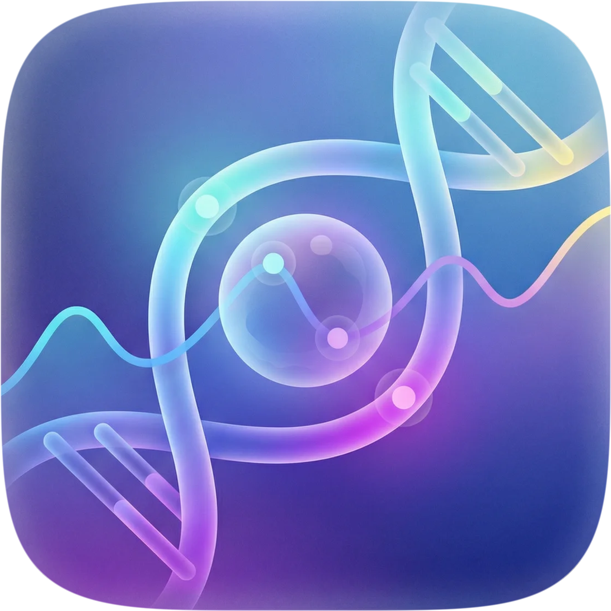
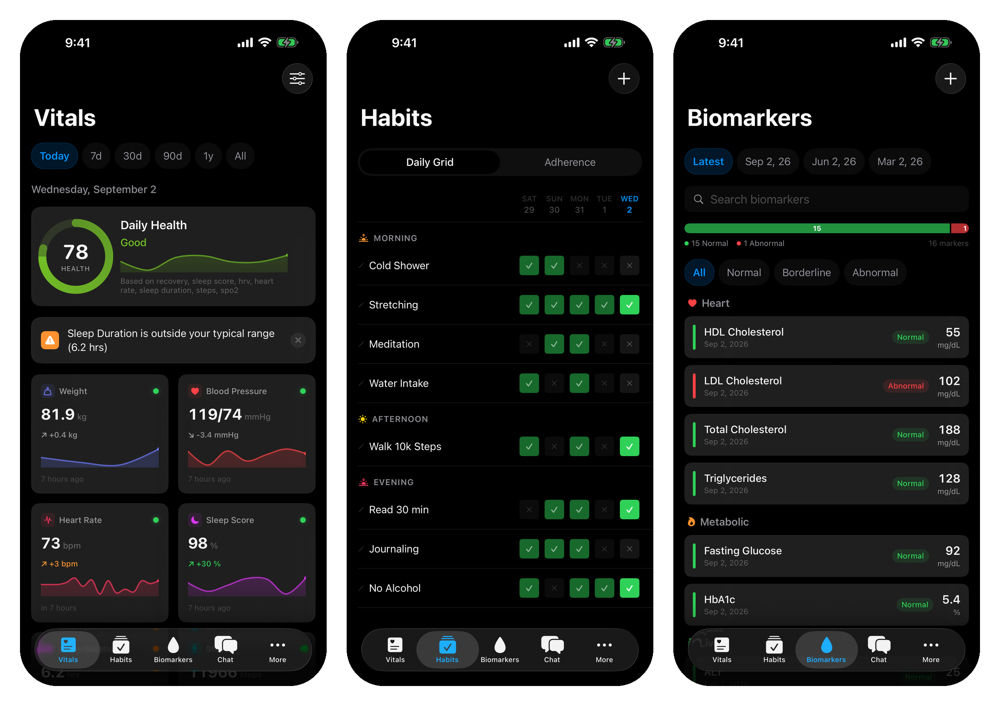

<h1>Aura Health</h1>

Your vitals, labs, medications, habits and health notes in one private dashboard. 
Built for people who want to understand their own data, not just collect it.

<strong>Version 1.0.0</strong> · iOS 26+

  
  
  

<a href="#install">Build Aura from source</a>

I started Aura after the spreadsheet where I tracked biomarkers, habits and health notes became harder to read than the data in it. It began as a web app; moving to Swift made a private iPhone app with Apple Health possible.

- Vitals from Apple Health and manual entries on one timeline, each with its trend and reference range.
- Labs grouped by body system, with every past session kept as a dated snapshot.
- An optional assistant that reads lab reports from a PDF or photo for you to review.

## How it works

Heart rate, HRV, blood pressure, sleep, steps, weight and more sit on one dashboard that says in one sentence what is outside your typical range; each metric opens a chart from 7 days to a year. Habits, medications, supplements, conditions and diet notes live beside the measurements they may affect. A full JSON backup can be created and restored. The tour is in [docs/tour.md](docs/tour.md).

## Privacy

There's no Aura account, health-data server, analytics or ads; data stays in Aura's local database on your iPhone. The assistant stays off until you add your own Anthropic or OpenRouter key and allow it. Then, only what you send, plus the records its tools read for that request, goes to that provider. See the [privacy policy](PRIVACY.md) and [support guide](SUPPORT.md).

## Limits

Lab extraction depends on the document's quality, so every extracted value stays editable before it's saved. Aura is an organizational and educational wellness tool. It is not a medical device and does not diagnose, treat, or replace advice from a qualified healthcare professional.

## Install

Aura is distributed as source while its first App Store release is prepared. Clone the repo, open `AuraHealth.xcodeproj` and build the iPhone target. Apple Health access is optional and read-only; the assistant is set up under **More › Settings › AI**.

---

[MIT](LICENSE). Icons by [Phosphor](https://phosphoricons.com) ([MIT](assets/icons/phosphor-light/LICENSE)).

Made by [santiagoalonso.com](https://santiagoalonso.com)
