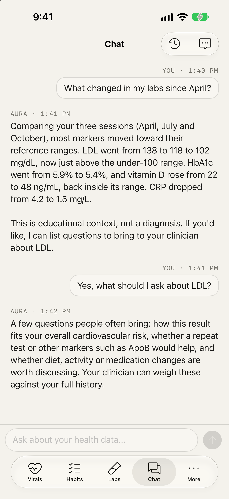

# A tour of Aura

What Aura tracks, the health assistant, and the tech stack. The short version is the [README](../README.md).

## What Aura keeps together

The main dashboard brings heart rate, HRV, blood pressure, sleep, steps, weight, SpO2, skin temperature, calories, and other measurements into one timeline. A one-line summary on top says what is outside your typical range, and flagged metrics come first. Each metric opens a chart (7 days to a year), its typical range, and a short explanation.

Habits, medications, supplements, conditions, diet notes, and lab sessions live beside the measurements they may affect. Biomarkers are grouped by body system, and each past lab report opens from the lab reports list with its own values and notes.

The health assistant runs on Apple's on-device model, so nothing leaves the iPhone. It answers questions from your vitals, labs, medications, conditions and habits, and logs a reading or habit when you ask, after you approve the change. Lab reports import from a PDF or photo on the Labs screen. For harder reports, you can add your own Anthropic or OpenRouter key in Settings; the assistant can then also read attachments, and nothing is sent until you allow processing.

## Tech stack

- Swift and SwiftUI for iPhone
- SwiftData for local storage
- read-only HealthKit integration
- Apple's Foundation Models for the on-device assistant
- Anthropic and OpenRouter for optional cloud AI, with provider API keys in the Keychain
